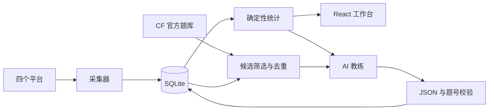

# 架构与数据边界

## 数据链路

题数、通过率、时间窗口、图表、去重由代码计算。AI 用于解释统计、判断可能的薄弱点、组织计划和从候选中选题；不会替代事实统计，也不创建不存在的题目。

## 模块

| 模块 | 职责 |
| --- | --- |
| app.py | 路由、访问令牌、会话、跨站保护、调度 |
| analytics.py | 平台/时间统计，UTC 存储，北京时间展示 |
| jobs.py | 异步任务与状态，阻塞采集放工作线程 |
| ai.py | API、提示词数据白名单、schema 与题号校验 |
| codex_bridge.py | 官方 RPC、本机登录、模型目录、临时分析线程 |
| catalog.py | CF 题库缓存、条件过滤与去重 |
| database.py | 独立 SQLite 连接 |

保留 submissions/accounts/snapshots/runs，新增 web_settings/web_jobs/ai_reports/problem_catalog/practice_feedback。Key 单独保存在权限 600 的 data/ai-secrets.json，不放入前端响应或统计表。

## AI 数据

发送所选窗口的计数、标签统计、最多最近 30 次提交的题目简要信息、训练偏好，选题时另有最多 60 个候选。不发送 Cookie、Key、官方登录 token、原始资料页、代码或浏览器数据库。

Responses 使用 JSON Schema，兼容 Chat Completions 使用 JSON 对象，再统一经过 Pydantic 校验。未完成、截断、非法题号不保存为成功报告。前端以 React 文本节点显示 AI 内容，不执行 HTML。

本机 Codex 使用官方客户端会话，分析线程只接收摘要。该子进程关闭 shell、插件、应用、MCP 和网页搜索；轮次使用受限只读沙箱，拒绝工具请求。模型列表可能缓存，实际调用才验证权限。生产部署禁用此通道。

## API

| 路径 | 用途 |
| --- | --- |
| GET /api/overview | 统计 |
| GET /api/submissions | 筛选分页 |
| GET /api/accounts | 不含 Cookie 的配置摘要 |
| POST /api/crawl | 后台采集 |
| GET /api/jobs | 任务状态 |
| GET/PUT /api/ai/settings | 接入配置，不回传 Key |
| GET /api/ai/account | 本机官方登录状态 |
| POST /api/ai/login | 浏览器/设备码登录 |
| GET /api/ai/models | 模型列表 |
| POST /api/analysis | 能力分析任务 |
| POST /api/recommend | 选题任务 |
| GET /api/reports | 报告目录 |
| GET /api/reports/{id} | 报告详情 |
| GET /api/catalog | 真实候选 |
| POST /api/catalog/refresh | 后台刷新题库 |
| POST /api/feedback | 完成/跳过反馈 |
| GET/PUT /api/training | 训练偏好 |
| GET/PUT /api/schedule | 每日工作流 |

本机 /api/docs 可查看参数。后台任务返回 job ID，前端轮询状态，完成后加载报告。

## 范围

单用户、单后端进程。令牌保护整个私人工作台，不提供多用户隔离。当前选题源为 CF，可新增题库适配器扩展。所有统计基于本地可见数据，不保证未公开或第三方尚未同步的记录。
