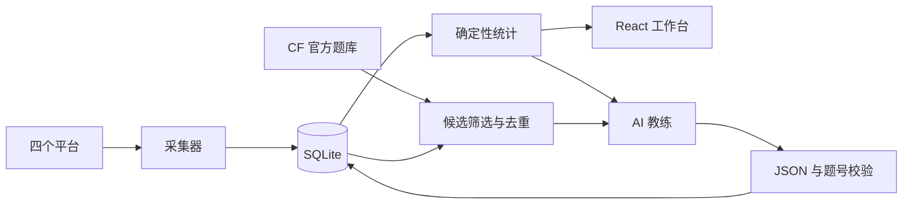

# 架构与数据边界

## 数据链路

题数、通过率、时间窗口、图表、去重由代码计算。AI 用于解释统计、判断可能的薄弱点、组织计划和从候选中选题；不会替代事实统计，也不创建不存在的题目。

## 模块

| 模块 | 职责 |
| --- | --- |
| app.py | 路由、访问令牌、会话、跨站保护、调度 |
| analytics.py | 平台/时间统计，UTC 存储，北京时间展示 |
| jobs.py | 异步任务与状态，阻塞采集放工作线程 |
| ai.py | API、提示词数据白名单、schema 与题号校验 |
| codex_bridge.py | 官方 RPC、设备码授权、模型目录、临时分析线程 |
| catalog.py | CF 题库缓存、条件过滤与去重 |
| workbench.py | 私人草稿/快照、CF 题面与判题核验、分步提示和错因复盘 |
| database.py | 独立 SQLite 连接 |
| accounts.py | 网页账号配置、主页解析、Cookie 更新及原子写入 |

保留 submissions/accounts/snapshots/runs，新增 web_settings/web_jobs/ai_reports/problem_catalog/practice_feedback 与 wb_problems/wb_drafts/wb_hints/wb_attempts。Key 单独保存在权限 600 的 data/ai-secrets.json，不放入前端响应或统计表。

## AI 数据

发送所选窗口的计数、标签统计、最多最近 30 次提交的题目简要信息、训练偏好，选题时另有最多 60 个候选。普通能力分析与选题不发送 Cookie、Key、官方登录 token、原始资料页、代码或浏览器数据库。新增工作台只在用户主动请求错因复盘时发送所选代码快照；一般报告接收聚合练习证据。

Responses 使用 JSON Schema，兼容 Chat Completions 使用 JSON 对象，再统一经过 Pydantic 校验。未完成、截断、非法题号不保存为成功报告。前端以 React 文本节点显示 AI 内容，不执行 HTML。

本机 Codex 使用官方客户端会话，分析线程只接收摘要。该子进程关闭 shell、插件、应用、MCP 和网页搜索；轮次使用受限只读沙箱，拒绝工具请求。模型列表可能缓存，实际调用才验证权限。生产默认禁用；显式开启后使用独立 CODEX_HOME 和设备码流程，多人模式下每位成员使用独立官方凭据目录，登录不会共享。

## API

| 路径 | 用途 |
| --- | --- |
| GET /api/workbench | 推荐列表、近期草稿与聚合练习证据 |
| GET /api/workbench/resolve | 规范化 CF 题号或官方链接，读取本题私有状态 |
| POST /api/workbench/open | 抓取公开 CF 题面与样例 |
| GET /api/workbench/problem/{pid} | 题面、私人草稿、提示与快照 |
| PUT /api/workbench/problem/{pid}/draft | 版本检查与保存 |
| POST /api/workbench/problem/{pid}/snapshot | 固定草稿版本的不可变快照 |
| POST /api/workbench/problem/{pid}/hint | AI 小提示任务 |
| POST /api/workbench/attempt/{id}/sync | 核验官方提交、可选自动复盘 |
| POST /api/workbench/attempt/{id}/review | 对未通过快照单独复盘 |
| GET /api/overview | 统计 |
| GET /api/submissions | 筛选分页 |
| GET/PUT /api/accounts | 配置摘要、保存完整平台账号列表；Cookie 不回传 |
| POST /api/crawl | 后台采集 |
| GET /api/jobs | 任务状态 |
| GET/PUT /api/ai/settings | 接入配置，不回传 Key |
| GET /api/ai/account | 官方登录状态 |
| POST /api/ai/login | 浏览器/设备码登录 |
| POST /api/ai/login/cancel | 取消设备码申请 |
| POST /api/ai/logout | 退出官方账号 |
| GET /api/ai/models | 模型列表 |
| POST /api/analysis | 能力分析任务 |
| POST /api/recommend | 选题任务 |
| GET /api/reports | 报告目录 |
| GET /api/reports/{id} | 报告详情 |
| GET /api/catalog | 真实候选 |
| POST /api/catalog/refresh | 后台刷新题库 |
| POST /api/feedback | 完成/跳过反馈 |
| GET/PUT /api/training | 训练偏好 |
| GET/PUT /api/schedule | 每日工作流 |

本机 /api/docs 可查看参数。后台任务返回 job ID，前端轮询状态，完成后加载报告。

## 范围

服务器默认多人、单后端进程。用户数据库保存身份和共享资料；各用户拥有独立训练数据库、配置、任务、调度器和官方客户端。旧单用户模式仍保留本机兼容性。当前选题源为 CF，可新增题库适配器扩展。所有统计基于本地可见数据，不保证未公开或第三方尚未同步的记录。

多人授权边界、数据目录、权限矩阵和运维步骤见 [多人版说明](MULTIUSER.md)。
