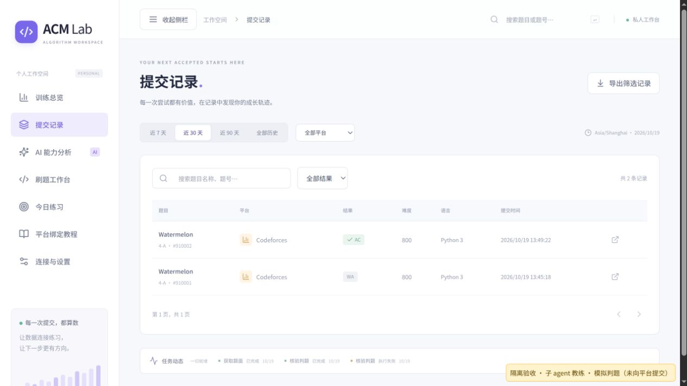
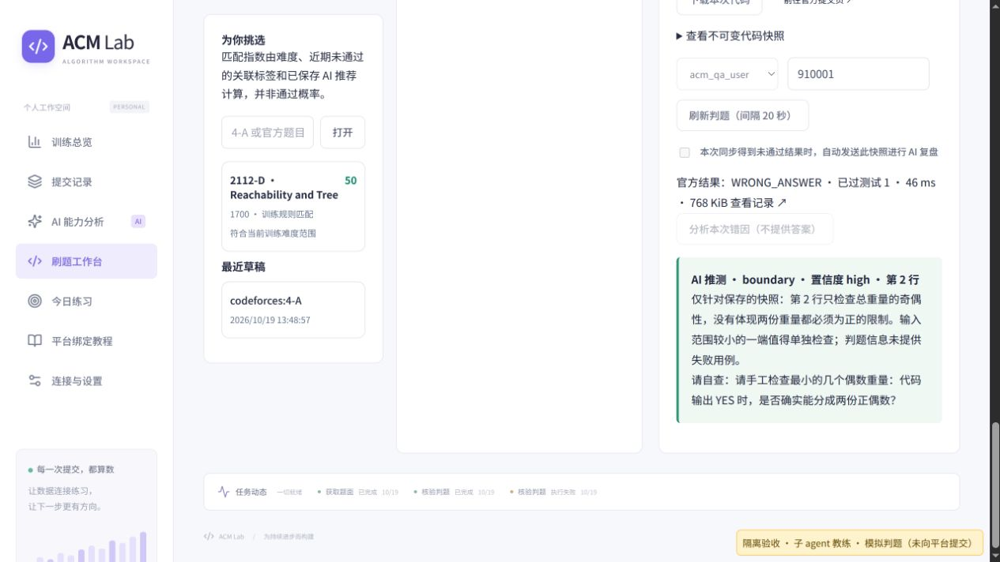
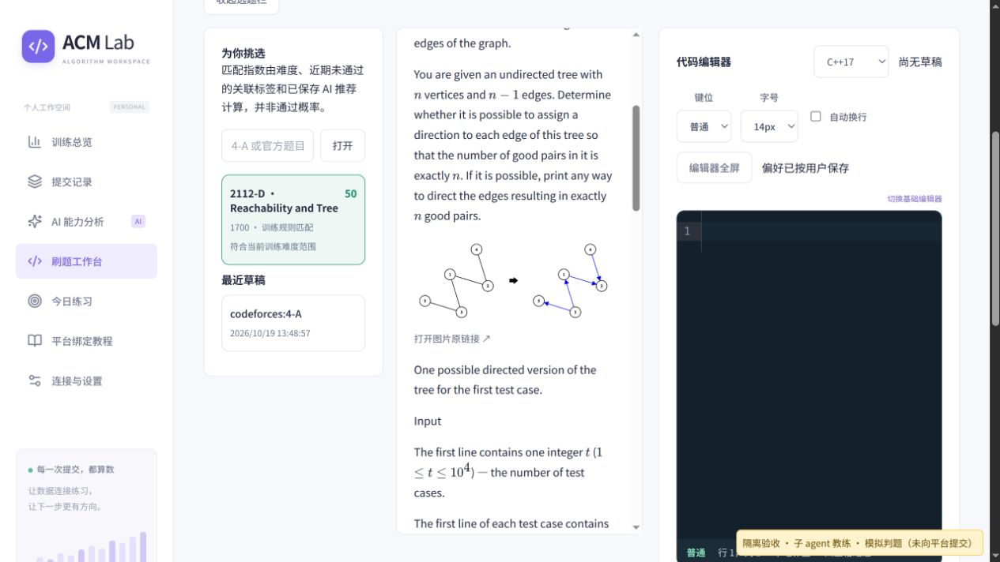

# 工作台用户流程验收（2026-10-19）

本轮由主 agent 使用鼠标和键盘操作网页，教练子 agent 实际处理界面发起的提示/复盘请求，审查与修复子 agent 分别检查实现和修复后台闭环。

用户选择先完成隔离验收。**题面来自真实 Codeforces；WA、AC 和判题明细为模拟数据，未向真实账号提交代码，也没有调用付费 AI API。** 不能将本轮结果当作真实远程交题、真实判题或真实 API 权限的验收。

## 环境与方法

- 独立本机服务 `127.0.0.1:18767`，数据库、账号和请求队列均在 `/tmp/acm-acceptance-20261019`，不使用用户历史数据库或 Cookie。
- 绑定虚构 handle `acm_qa_user`；模拟提交号 `910001`（WA）、`910002`（AC）、`910003`（错误题号）。
- 实际调用生产工作台的草稿、快照、任务、题面抓取、判题校验、SQLite 保存与结果展示；仅替换隔离进程的上游判题响应和 AI 生成传输。
- AI 请求写入请求队列后，由教练子 agent 阅读本次真实 prompt/schema，再原子写入响应。输出仍经过生产 Hint / Review 校验器。并非提前写死固定提示。
- 新增的 CI 浏览器回归使用 `scripts/editor_test_server.py` 的合成题面与固定响应，可通过 `ACM_TEST_PYTHON=../.venv/bin/python npm --prefix frontend run test:e2e` 重现页面流程。测试服务仅监听回环且需测试开关，不改变生产服务。

## 鼠标操作结果

| 流程 | 观察结果 |
| --- | --- |
| 选题并抓取 `4-A` | 真实 Watermelon 正文、输入输出、样例可读，非 Markdown 源码 |
| 输入故意错误的 Python3 解法 | 只判断总重奇偶，遗漏较小输入边界；草稿显示服务器保存成功 |
| 未绑平台时保存快照 | 显示 UNLINKED，明确提示绑定 handle、登录 CF 和去官方页面手动提交；关联按钮禁用 |
| 点击官方提交入口 | 内置浏览器未登录，CF 退回首页并提示不允许查看；没有真实提交成功 |
| 在设置页绑定账号 | 用表单保存虚构 handle，无 Cookie；返回后账号可选 |
| 未选模型/未同意发送 | 提示按钮禁用，不调用教练 |
| 请求两次提示 | 子 agent 第一次引导理解两份正偶数限制；第二次实际携带一条历史提示，进一步检查小输入；未给完整解法或代码 |
| 故意填写错误题号的提交号 | 后台拒绝，界面显示账号或题号不匹配，快照仍未关联 |
| 关联 WA 并勾自动复盘 | WA、测试数、耗时与内存显示；子 agent 收到两条提示历史及本地快照，指出第 2 行的边界疑点，没有编造失败用例 |
| 修改草稿并保存第二份快照 | 旧错误快照内容和哈希不变；新代码具有独立快照 |
| 同一平台提交关联第二份快照 | 明确拒绝重复关联 |
| 关联修正版本的模拟 AC | AC 独立保存，旧 WA 仍保留；AC 没有错因复盘入口 |
| 统一提交记录 | WA/AC 两条均可见，可筛选 WA，题号旁显示提交号及官方记录入口 |
| 切页、重启与恢复 | 两次提示、草稿、快照和复盘保留；同意发送开关重新由用户选择 |
| 导航收放 | 明显文字按钮可控制；切换栏目保持当前收放状态 |
| 换带图题 `2112-D` | 真实正文、公式、1 组样例和 2 张图片保留；浏览器确认两图已完成解码，原始尺寸为 700×300、300×300，仍有原链接 |

## 发现并修复

1. 采集更新重判后只改变统一提交表，工作台仍用旧判题。现在同步已关联快照和训练证据，判题变化清除旧复盘；在途 AI 不能写回过期分析。
2. CF handle 仅改大小写时刷新被误判为另一账号；重复历史也可能新增。现在关联、采集及主键复用按 CF 大小写规则处理，已有历史不合并、不删除；界面同步显示正确账号。
3. 已做题被旧 AI 推荐无条件补回。现在补回同样排除已尝试、已完成和已跳过题。
4. 旧版仅保存部分训练偏好时，设置表单读取缺失数组会白屏。读取时补齐默认值，保留已保存的偏好。
5. 长标题与分数互相挤压。推荐卡支持换行，主面板按实际可用宽度决定列数；统一记录增加提交号便于核对。

后台回归另覆盖未知/排队/测试中判题不会当成已完成失败，不会因此进行错因复盘或计入薄弱知识点。

验证：118 项 Python、12 项组件、10 项 Chromium 测试通过，生产构建通过。浏览器回归也包含 Vim、补全、草稿冲突、窄屏、题面公式/图片及配置页。

## 仍未验证或未实现

- 工作台没有自动远程代提交能力，仍是「快照 → 原站手动提交 → 关联提交号」。
- 本轮没有真实登录、远程提交或实测真实隐藏判题；模拟 AC 不能证明程序正确。
- 服务器不执行用户代码。当前仅核验账号、题号和时间，不能证明平台源码与本地快照一致。
- 子 agent 的语义检查证明本次三条输出克制，不能保证其它模型或所有后续回答都不泄露答案。

## 界面证据

[教练实际返回的 JSON](acceptance/2026-10-19/coach-responses.json)

