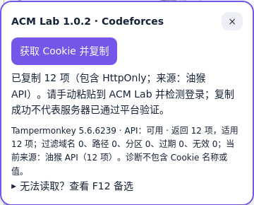
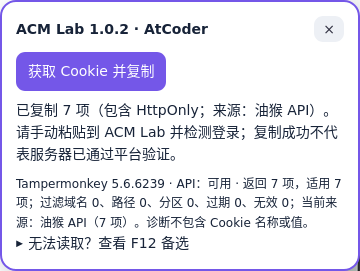
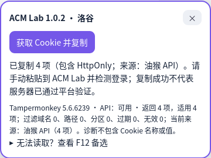

# 真实登录会话的油猴导出验收

日期：2026-10-20。用户不在电脑旁，授权先验证已能登录的平台。仅本机开发验收；未部署、未连接服务器、未提交代码、未自动处理验证码。

## 环境与方法

- Firefox 157.0.1、geckodriver 0.37.1，新建临时默认 profile；没有向用户日常 Firefox 安装扩展或修改设置。
- 从[官方 Beta 地址](https://www.tampermonkey.net/xpi/firefox-current-beta.xpi)下载 Tampermonkey 5.6.6239，真实安装，使用真实管理器编辑器导入项目助手1.0.2。没有模拟 GM Cookie API 或剪贴板。
- 读取真实设置：Settings → Config mode: Advanced → Security → Allow scripts to access cookies 为 All。稳定版5.50不在本轮通过结论内。
- 使用用户此前授权并在官方页面登录成功的本机内置浏览器会话，保持原 domain/path/secure/HttpOnly/SameSite/expiry 元数据，转入隔离 Firefox。不是声称日常 Firefox 的旧 Cookie 已经可用，也不是用合成 Cookie 冒充登录。CF 旧会话已失效，本轮使用用户之前授权的账号重新在官方登录后再验收；洛谷原官方页面刷新后仍显示本人及登出入口。
- 在隔离 Firefox 的官方页面点击实际助手按钮，由真实剪贴板读回结果，在本机内存按 name/value 多重集合对照 WebDriver 当前页面 Cookie 集合，包括 HttpOnly。只输出数量、状态和布尔结果，不记录 Cookie 名称、值、密码或页面原文。
- 将同一份助手导出值交给项目真实 CredentialChecks，访问固定官方身份检测页；要求官方当前身份与私有配置的本人 handle/UID 匹配，不以 Cookie 数量或公开主页当作成功证据。
- 完成后清空实验剪贴板、关闭自建 Firefox/geckodriver 并删除临时 profile。原内置浏览器会话保留，用户私有 account.toml 未被本次测试覆盖。

## 发现并修复的问题

助手1.0.1查询未分区 Cookie，遗漏 CF 当前站点分区中的一项 HttpOnly。前后 Cookie 集合保持不变，再次点击仍少一项，排除了页面新增 Cookie 的竞态。Firefox 存储元数据确认该项 partitionKey 为 `(https,codeforces.com)`，且非容器、非隐私窗口、非过期；详见[修复前结果](before-fix-cf-partition.json)。这时后台虽然已经能验证账号，但不能宣称导出集合完整。

[官方 Cookie API 文档](https://www.tampermonkey.net/documentation.php?q=GM_cookie)提供 partitionKey.topLevelSite 查询。助手1.0.2分别查询未分区及当前站点分区，不使用返回所有分区的空对象；返回值仍逐项检查域名、路径、到期时间和分区。其他站点分区、未知分区、跨站祖先分区、首方隔离与容器会话均排除。两次结果去重时区分普通与分区 Cookie；分区查询失败时即使已有 HttpOnly，也要求另行明确确认部分复制，不能悄悄当完整导出。

## 修复后真实结果

| 平台 | 导出 / 浏览器当前页 | HttpOnly 全部导出 | 官方当前身份（隔离 Firefox） | ACM Lab后台 |
| --- | --- | --- | --- | --- |
| Codeforces | 12 / 12，集合相同 | 3 / 3 | 与配置匹配 | HTTP200，authenticated / identity_verified |
| AtCoder | 7 / 7，集合相同 | 4 / 4 | 与配置匹配 | HTTP200，authenticated / identity_verified |
| 洛谷 | 4 / 4，集合相同 | 2 / 2 | 无法确认；原内置浏览器刷新后仍登录 | HTTP418，blocked / access_restricted |
| 牛客 | 未执行已登录 Cookie 验收 | 未验 | 需本人扫描官方二维码 | 不声称通过 |

原始无凭据结果：[JSON](beta-platform-cookie-results.json)。导出范围为当前页面适用 Cookie，不代表所有路径、所有子域或其他容器 Cookie；本机后台通过也不保证另一个服务器出口不受限制。本轮没有真实交题验收，不能扩大为“自动代交通过”。

## 实机截图

截图仅包含助手卡片，未展示 Cookie 或个人设置。

## 使用新版

回到 ACM Lab 连接与设置，复制新版助手源码；在油猴编辑原脚本，全选替换并保存，再刷新平台。标题应为 ACM Lab 1.0.2。Firefox需使用本轮验证的官方 Beta 并允许 HttpOnly；不要同时运行稳定版和 Beta 中的两份助手。复制后回 ACM Lab 保存并检测登录。
