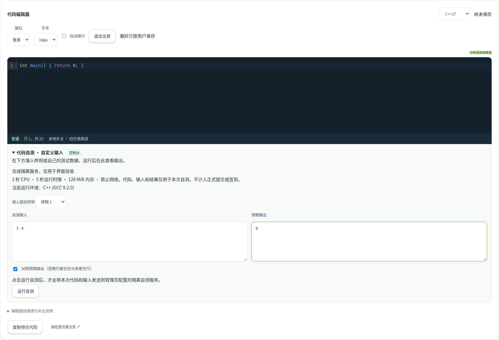
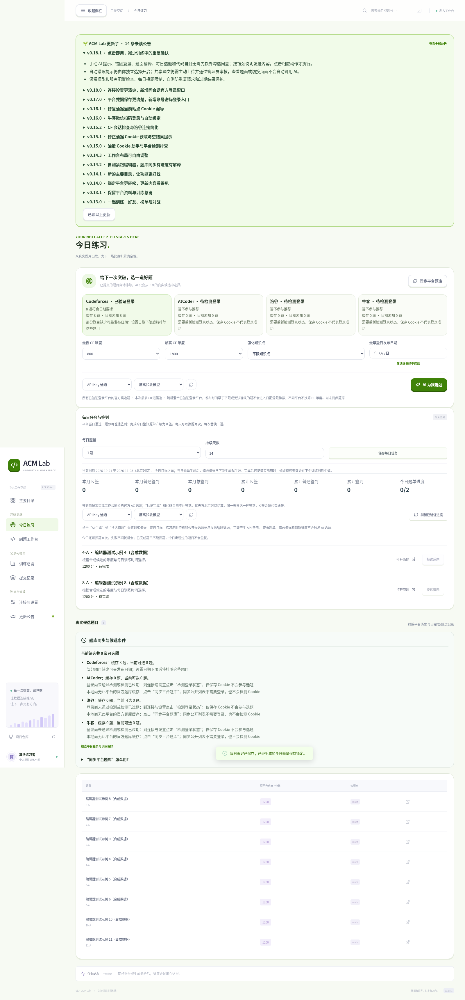

# 0.18.1 点击动作验收

本轮补齐“使用功能无需反复勾选确认”的目标。普通手动动作以明确点击为发起点，说明数据去向和计费可能；保留自动提示偏好、代码与提交是否一致的事实确认、公开分享与上传审核操作。

## 多代理分工与结果

- settings_motion：翻译与每日选题，相关15项组件测试通过。只在点击翻译/生成/换题时请求；无模型、服务未配置、已在生成或换题次数不足时不能执行；共享仍需主动上传。
- 根代理：手动提示、错因与自测，增加自测同步防重复锁；模型选择和背景刷新不会发起AI任务。完整前端20个文件、143项组件测试与TypeScript/Vite构建通过。
- nowcoder_qr_verifier：只读复核调用路径，确认自动错误提示仍默认关闭且独立开启，自测服务/语言/空代码检查、旧结果和跨题卸载保护仍存在。没有发现新增自动外发路径。
- 相关后端49项通过：公告、每日任务、自测、翻译。
- 52项完整Playwright端到端通过；进程在中断后已退出，结果从更新后的 .last-run.json（status=passed、failedTests为空）恢复，不重复启动。题目、AI、判题与翻译上游是隔离合成数据，不冒充真实付费AI或官方交题。

## 实际交互覆盖

工作台选择模型前禁用手动提示；选择后无需勾选即可点击。选择、编辑与刷新时手动AI请求数为0；点击小提示后为1，点击WA错因后为2；关联AC不会显示错因按钮。自动提示仍按独立偏好运行。

自测只保留“对照预期输出”这一功能选项。填样例和编辑不会发送代码，点击运行才发送；连续双击只产生一次请求，更改代码后的旧结果不展示。自测不是官方AC，不生成提交或签到。

每日题单点击前roll请求数为0，生成一次加两次换题合计3次；次数用尽按钮禁用，偏好保存与刷新不调用AI。翻译三种引擎都由按钮发起，生成不自动上传，审核分享流程保留。

以下是隔离验收界面截图，仅展示布局及按钮流程，不是真实平台判题或真实模型结果：

四平台真实登录的已确认结果与未完成项沿用[平台验收记录](../2026-10-21-platform-login/VALIDATION.md)。本轮额外确认洛谷现有Firefox会话在隔离Chromium中的身份与绑定通过；CF/AtCoder新密码登录及牛客新扫码仍不能声称通过。没有部署。
