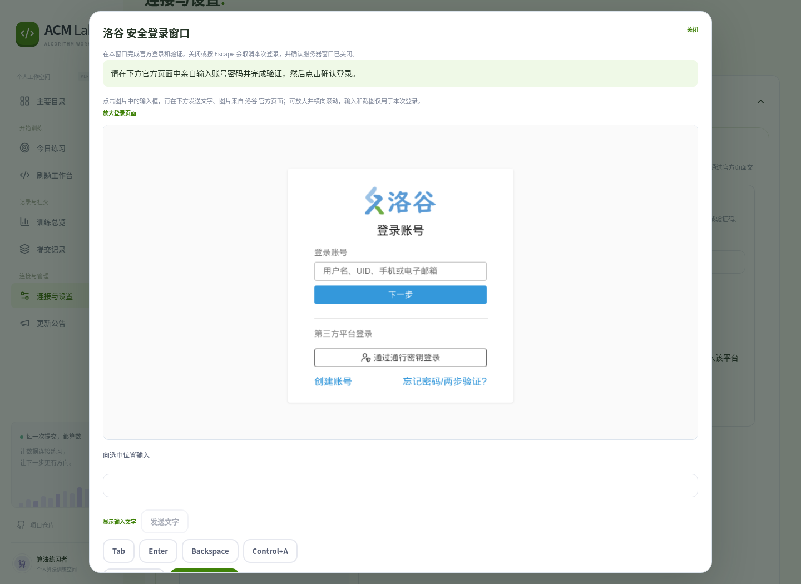

# 登录按钮原页刷新的修复验收

用户反馈点击“打开安全登录窗口”后原地跳转，没有看到弹窗。本轮分别检查了接口和界面，未改动真实账号配置，也未部署服务器。

## 根因

- 临时验收实例误设 `Settings.isolated=True`，被当作需要多人父应用提供身份的子工作区。直接访问该实例没有父会话，登录 `start` 实测返回 401、“请重新登录 ACM Lab”；前端全局会话失效处理刷新原页。
- 原有界面只在平台卡片内展开截图，并非弹窗；活动卡片扩整行也会引发视觉跳动。

修正临时实例配置，保留生产子工作区的身份检查。新增 `scripts/login_acceptance_server.py`，显式使用单用户模式、空账号配置、临时数据库、禁用 Codex 和环境 AI Key，只监听本机。退出清除临时数据。

## 实际前端 → 后端 → 官方页面

使用该脚本启动独立的 `127.0.0.1:18771` 实例，再用真实 Chromium 点击网页的洛谷登录按钮，未拦截或模拟登录接口：

- 原生 `dialog.showModal()` 弹层实际可见，官方洛谷登录页截图实际可见。
- `start`、`image`、`cancel` 均返回 200。
- 主页面导航次数为 0，按 Escape 后取消并关闭弹层，焦点回到打开按钮。
- 没有输入账号、密码、验证码，没有保存账号。此项仅证明窗口链路恢复，不能作为新密码登录成功证据。

用于这项检查的 18771 实例与测试浏览器均已关闭并清理；提供本人操作的 18770 临时实例独立运行。

## 自动化与独立复核

- 前端全部组件测试 151 项通过，其中登录组件 24 项；TypeScript / Vite 构建通过。
- 本次相关后端测试 166 项通过、1 项官方被动探针未启用而跳过。
- 平台绑定端到端 4 项通过，涵盖立即打开原生模态框、无导航和新窗口、卡片尺寸稳定、手机布局、隐藏输入、取消、焦点恢复及启动失败后的手动 Cookie 入口。
- 独立代理只读复核通过。启动中关闭且请求拒绝或长期无响应时，等待不超过原始启动时刻加 300 秒；未知会话不会伪报取消成功，迟到响应不会覆盖新会话。取消失败保留明确重试入口。

首次浏览器检查发现无根滚动条时强设 `scrollbar-gutter: stable` 会使四列卡片各缩窄 3.75 像素，已改为按实际滚动条存在情况保留空间，再次检查通过。弹层开启时背景不可操作，返回手动配置的测试同步改为先关闭弹层。

四平台新登录的剩余验收状态仍见[平台验收记录](../2026-10-21-platform-login/VALIDATION.md)，不因修复窗口或自动化通过而改写为成功。
