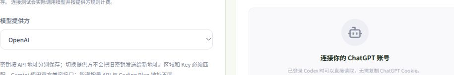
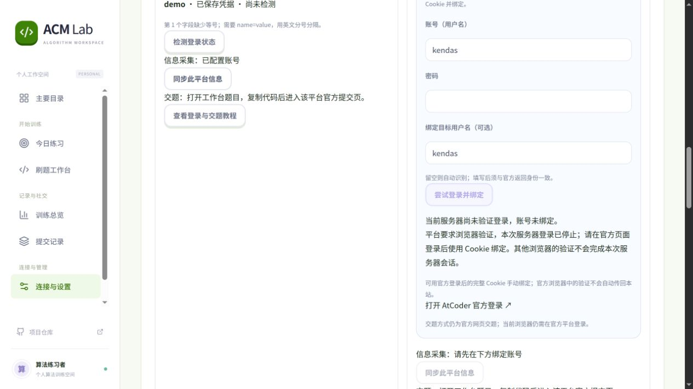

# 0.17.0 平台绑定与登录验收

日期：2026-10-21。多agent分别检查保存/检测链路、现有登录能力、油猴与服务端协议；两名worker实现密码入口/服务端，独立verifier核对隔离及注销边界，根agent用鼠标实际操作本地网页。仅开发和本机验收，未部署、未交题、未修改用户日常Firefox。

## 反馈定位

1. 当前编辑接口有意不返回Cookie，编辑框为空但留空会保留原值。此前只在placeholder说明，容易被误认为没有保存。现在显示服务器保存状态、字段数和具体错误，并明确留空保留、输入替换、显式清除。
2. 旧配置中保存非法字段（例如缺少等号或带Cookie:前缀），编辑留空会保留旧值；保存配置不代表原Cookie变合法。使用纯临时合成配置重现“保存成功，但随后invalid”，没有据此断定用户服务器上的实际输入就是此情况。
3. 油猴允许合法值包含连续英文点号，服务端却对任意位置的`...`拒绝，存在明确协议不一致。本版修复，不再用任意子串推断截断；单行Cookie:可安全整理，Set-Cookie、多行/控制字符、非法名称仍拒绝。
4. 之前站内只有牛客微信扫码入口；CF/AtCoder/洛谷是官方网页登录测试，不是站内密码功能。本版新增CF与AtCoder的真实服务器表单流程，但真实可用性仍受平台验证限制，不扩大为已跑通。

## 本地网页实际操作

使用隔离临时工作区，初始CF账号/非法Cookie均为合成数据；服务端身份检测调用真实固定CF设置页。

- 鼠标点击编辑，看到旧值的具体“第1字段缺少等号”和不回填说明。
- 粘贴带Cookie:及合法连续点号的合成值，点击保存，服务器规范化为两项；界面自动启动平台身份检测。
- 平台真实返回HTTP302，界面正确显示需要重新登录，而不是格式不完整；合成凭据不具有登录能力，不能把这一结果称为真实CF登录通过。
- 再次编辑仍显示服务器已保存2项，框内为空；端到端回归还验证留空保留、显式清除、Cookie不在公开API回显，以及输入宽度和手机展开布局。

[完整界面](cookie-edit-saved.png)

## 密码入口真实验证及边界

- CF：用用户此前授权的账号经本地ACM Lab新表单尝试，平台返回浏览器验证，未绑定。
- AtCoder首次：同样通过新表单真实尝试，未取得官方身份，返回未完成登录，未绑定。不能断言密码本身错误。
- 随后agent只读请求官方/login两次，确认“精确Cloudflare Turnstile脚本 + 密码form内data-sitekey/data-theme验证容器”；初始HTML没有常见验证class及响应字段，原检测遗漏。
- 在密码form解析中补双条件识别；只加载脚本并不会误阻断普通页面。最终通过新表单真实复测，只发生一次 `GET https://atcoder.jp/login`、HTTP200，即在发送密码前返回blocked/browser_challenge。计数记录见[真实出站请求](real-preflight.json)，没有任何密码或Cookie值。
- 每次尝试后密码输入均清空；未保存密码、未覆盖原账号，当前没有真实账号密码登录成功证据。此前CF/AtCoder Cookie导出及身份检测的成功记录不能替代本流程通过。
- 牛客继续已有微信扫码，最终本人扫码仍待本人；洛谷保持公开同步和官方交题，未重新加入无法操作的访问限制引导。

## 独立安全复核

独立agent新增真实多用户ASGI回归，覆盖未登录401、缺CSRF403、两用户绑定隔离，以及登录在线程处理期间调用真实注销接口，禁止在途结果落库。另检查固定官方URL、表单action与已知callback校验、失败不回显秘密、配置revision防覆盖、并发/总时限/大小/冷却限制。

`remember_verified`只在官方身份核对及成功绑定后填充近期检查，并重新核对当前Cookie精确相同；更换或删除Cookie后旧成功不再适用。最终156项相关独立测试通过，未发现阻断问题。检测可能保守阻止未来放入惰性模板的验证组件，当前官方活跃表单无此情况；不会为此发送密码或误报成功。

原始脱敏结果：[results.json](results.json)。维护者自行更新站点到0.17.0；本次没有部署。
